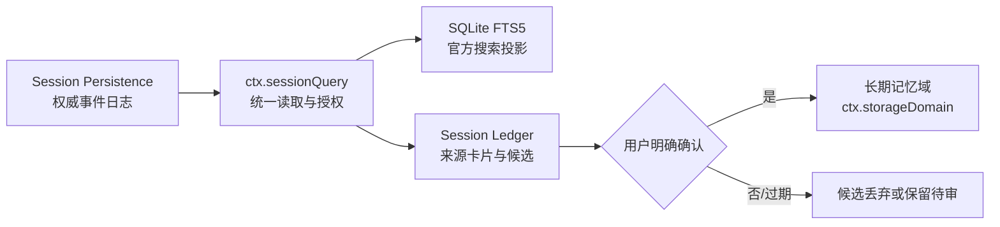

# DSH Session Ledger：可追溯会话证据与用户确认式长期记忆

| 项目 | 内容 |
| --- | --- |
| 状态 | Draft v0.1 |
| 日期 | 2026-11-18 |
| 目标 | DeepSeek Harness 社区插件 / 可独立评审的设计 |
| 暂定包名 | `dsh-session-ledger` |

## 1. 摘要

本项目为 DeepSeek Harness 增加一层“会话证据账本”和“长期记忆晋升”能力：Agent 找到历史会话中的相关事件后，返回带有会话、事件、时间和工作区来源的证据卡片；只有用户明确确认，证据才会被保存为长期记忆。

项目不重复实现会话全文搜索。当前 Harness 已提供 `ctx.sessionQuery`，并由 `@deepseek-ai/dsh-session-query-sqlite` 提供 SQLite FTS5 搜索、持久化派生索引、分页和事件读取能力。插件在其上增加记忆语义、来源链、确认状态、删除与审计，并补足索引健康状态和性能验收。

最终目标是在包含 100,000 条历史事件的测试工作区中满足：

1. 重启后不因插件启动而全量重建搜索索引；
2. 从查询到返回带来源证据的相关会话，p95 小于 1 秒；
3. 每条候选结果都能回到具体 `workspace_id / session_id / event_seq / timestamp`；
4. 未获得用户确认时，任何候选都不能进入长期记忆；
5. 删除、导出和撤销操作可验证。

“不全量重建”和“1 秒内”是可测量的验收目标，不是假设官方后端在所有机器和版本上都已满足的事实。

## 2. 背景与现有能力

### 2.1 已有能力

- `@deepseek-ai/dsh-session-query` 提供统一的会话历史查询接口，包括会话列表、精确读取、事件过滤、关系追踪，以及 `searchSessions()` / `searchEvents()`。
- `@deepseek-ai/dsh-session-query-sqlite` 使用独立的 SQLite FTS5 派生数据库进行带排序的全文搜索。它不修改权威会话持久化存储，实时会话和持久化历史由查询服务统一观察。
- `@deepseek-ai/dsh-experimental-session-search` 是一个面向 Agent 的工具包，但默认使用 `:memory:` 索引，重启后需要重新建立索引，且仍属于实验能力。
- `@deepseek-ai/dsh-storage-domain` 提供带 schema 校验、可跨重启保存的非会话数据，适合保存长期记忆和确认审计；记忆不应伪装成会话事件。

### 2.2 本项目解决的空白

已有查询能力回答“哪些历史事件匹配”，但没有统一回答以下问题：

- 这条信息来自哪个会话、哪个事件、哪个工作区？
- Agent 是在什么依据下提出这条长期记忆的？
- 用户是否明确确认过？确认的是哪一版内容？
- 原始证据被删除、替换或不可访问后，长期记忆如何标记？
- 索引是否已追上权威会话存储，还是已经静默过期？

因此本项目的差异化重点是“证据到记忆的可审计转换”，而不是另一个向量库或另一个全文搜索工具。

## 3. 目标与非目标

### 3.1 目标

1. **可追溯检索**：所有返回的记忆候选都带来源指针和可读摘要。
2. **增量与重启友好**：复用官方持久化查询后端；正常重启只恢复索引状态并处理新增或变更部分。
3. **显式确认**：候选、编辑后的内容和最终保存动作分离；没有一次性、不可伪造的用户确认令牌，不允许晋升。
4. **工作区隔离**：默认只查询当前 Agent 有权访问的工作区，禁止跨工作区意外召回。
5. **可运维**：暴露索引滞后、最近检查时间、最后索引事件和错误原因，避免“数据库存在但结果过期”无法判断。
6. **可验证删除**：删除长期记忆后，后续查询不可返回；保留必要的删除审计，不保留被删除的正文。

### 3.2 非目标

- 不自行实现 JSONL 会话读取、SQLite FTS5 或另一套事件索引。
- 不自动把所有历史内容摘要后写入长期记忆。
- 不在第一版引入向量数据库、远程同步、知识图谱或跨用户共享记忆。
- 不默认把大量历史内容自动注入每次模型请求。
- 不在第一版深度耦合 `dsh-superagent`；先提供稳定的通用账本接口，再做 Ticket 适配器。
- 不承诺在所有 Harness 版本上都能绕过官方索引后端的缺陷；发现缺陷时应提交可复现的上游 Discussion，并在插件中给出可见的降级状态。

## 4. 设计原则

### 4.1 权威来源分层

会话 JSONL/Session Persistence 是事件的权威来源；`session-query-sqlite` 是可重建的搜索投影；Session Ledger 的长期记忆是用户确认后的业务数据。三者不互相冒充：



### 4.2 证据优先于摘要

长期记忆必须保存来源指针，而不是只保存一段无法验证的摘要。默认保存短摘要和哈希，不复制完整原始事件；用户查看时再通过 `ctx.sessionQuery.readEvent()` 读取授权范围内的原文。

### 4.3 确认是状态机，不是提示语

“请确认”出现在界面或模型文本中不等于确认。只有由用户操作产生、绑定到候选内容哈希和来源版本的 `confirmation_token` 才能完成晋升。

## 5. 核心概念与状态

### 5.1 对象

- **Evidence**：来自历史会话的一个或多个事件引用。
- **Candidate**：根据 Evidence 形成、尚未写入长期记忆的候选事实或偏好。
- **Memory**：用户确认后持久化的长期记忆。
- **Ledger entry**：记录 Candidate/Memory 的生命周期、来源、确认和删除审计。

### 5.2 Candidate 状态机

```text
DISCOVERED -> PRESENTED -> CONFIRMED -> PROMOTED
                 |             |
                 v             v
              DISMISSED     EXPIRED

PROMOTED -> REVOKED -> DELETED
```

状态转换约束：

- `DISCOVERED -> PRESENTED` 只创建候选，不产生长期记忆；
- `PRESENTED -> CONFIRMED` 必须由用户动作完成，并校验候选内容哈希未变化；
- `CONFIRMED -> PROMOTED` 写入记忆和审计记录，重复请求必须幂等；
- 来源不可读、工作区授权失效或候选超过保留时间时，不能直接晋升；
- `DELETED` 是终态，正文不可恢复，审计只保留必要元数据。

## 6. 数据模型

以下是逻辑模型，实际 schema 使用 Harness storage-domain 的 record schema 定义。

### 6.1 EvidenceRef

```ts
type EvidenceRef = {
  workspaceId: string
  sessionId: string
  eventSeq: number
  eventTime: string       // ISO 8601
  sourceKind: 'session-event'
  sourceGeneration?: string
  snippet: string          // 有界短片段，禁止保存整段事件
  contentHash: string      // 证据内容哈希，用于确认时校验
}
```

### 6.2 CandidateRecord

```ts
type CandidateRecord = {
  id: string
  workspaceId: string
  state: 'discovered' | 'presented' | 'confirmed' | 'promoted' | 'dismissed' | 'expired'
  proposedText: string
  proposedTextHash: string
  evidence: EvidenceRef[]
  createdAt: string
  expiresAt: string
  pendingConfirmation?: {
    confirmationId: string
    issuedAt: string
  }
  confirmation?: {
    tokenId: string
    confirmationId?: string
    issuedAt?: string
    confirmedAt: string
    confirmedTextHash: string
    consumedAt?: string
  }
}
```

### 6.3 MemoryRecord

```ts
type MemoryRecord = {
  id: string
  workspaceId: string
  text: string
  kind: 'preference' | 'decision' | 'project-fact' | 'workflow-rule' | 'other'
  sourceCandidateId: string
  evidence: EvidenceRef[]
  createdAt: string
  updatedAt: string
  revokedAt?: string
  deletedAt?: string
  schemaVersion: 1
}
```

M5 在晋升前重新读取每个 `EvidenceRef`，验证 workspace、session、事件序号、内容哈希，以及候选记录存在时的 `eventTime` 和 `sourceGeneration`。来源不可读、身份改变、版本改变或授权失效都会阻止晋升。

第一版不保存 `numeric relevance score`，因为官方 `sessionQuery` 的跨会话结果契约不把具体分数作为稳定 API；账本展示结果顺序、匹配片段和来源即可。

## 7. 组件与接口

### 7.1 Host-side service

插件提供一个非模型专用的 `ctx.sessionLedger` 服务，负责：

```ts
interface SessionLedger {
  searchEvidence(request: EvidenceSearchRequest): Promise<EvidencePage>
  createCandidate(input: CandidateInput): Promise<CandidateRecord>
  issueConfirmation(candidateId: string): Promise<ConfirmationPreview>
  promote(candidateId: string, token: ConfirmationToken): Promise<MemoryRecord>
  listMemories(scope: MemoryScope): Promise<MemoryRecord[]>
  revoke(memoryId: string): Promise<void>
  delete(memoryId: string): Promise<void>
  health(): Promise<LedgerHealth>
}
```

`searchEvidence()` 只调用 `ctx.sessionQuery.searchSessions()` / `searchEvents()` 和 `readEvent()`，不直接访问 Session Persistence 或 SQLite 文件。

### 7.2 可选模型工具

第一版可以注册以下只读或受确认保护的工具：

- `memory_search`：查询当前授权工作区的长期记忆和历史证据；
- `memory_candidate_preview`：生成候选及证据卡片；
- `memory_promote`：只接受由用户确认流程签发的 token；
- `memory_revoke`：撤销一条已保存记忆。

工具名称和 schema 需要在实际 Harness 版本上验证；如果 UI 确认通道尚未稳定，先只发布 Host-side service 和 CLI/测试适配器，不把“模型自己调用 promote”当作确认。

### 7.3 存储域

长期记忆和账本记录使用 `ctx.storageDomain`，建议建立 `session_ledger` 域（包名仍为 `dsh-session-ledger`）：

- `candidates`：候选及状态；
- `memories`：已确认长期记忆；
- `audit`：确认、撤销、删除等不可变审计元数据；
- `meta`：schema 版本、迁移标记、插件配置摘要。

由于 storage-domain 当前不提供跨表事务和二级索引，晋升流程采用幂等 ID、状态检查和补偿扫描：先写入 `CONFIRMED`，再写 Memory，最后更新为 `PROMOTED`；启动时扫描未完成状态并安全补偿，不重复创建记忆。

## 8. 查询、确认与晋升流程

1. Agent 或用户发起查询，例如“找出上次项目 A 的部署约定”。
2. `searchEvidence()` 将查询限制在当前授权工作区，调用 `ctx.sessionQuery` 获取会话命中，再读取有界事件窗口。
3. 插件返回最多 20 张证据卡片，每张包含会话标题（若可用）、`session_id`、`event_seq`、时间、匹配片段和授权状态。
4. 用户选择一张或多张证据，插件创建 Candidate；候选文本必须展示给用户编辑或确认。
5. 插件生成 `confirmation_token = HMAC(candidate_id + proposed_text_hash + evidence_hash + expiry)` 的等价不可伪造凭证。具体密钥管理由宿主配置提供，不能写进工作区文件。
6. 用户确认后，调用 `promote()`；插件重新读取证据元数据，校验工作区授权、候选哈希、token 有效期和来源版本。
7. 校验通过后写入 MemoryRecord 和审计记录；后续 `memory_search` 可检索该记忆并展示原始来源。

若证据在确认前已被删除、替换或变得不可授权，晋升失败并返回可解释错误，不能静默保存一条失去来源的记忆。

## 9. 索引、重启与一致性策略

### 9.1 正常路径

- 使用带持久化路径的 `@deepseek-ai/dsh-session-query-sqlite`，而不是实验 bundle 默认的 `:memory:` 路径。
- 启动时读取官方查询服务的可用性和索引状态；已有索引直接复用。
- 新增或变更事件由官方查询后端增量 reconcile；插件只消费查询结果，不扫描 100,000 条原始日志。
- 长期记忆域独立于会话索引，插件重启只需打开并校验自己的 domain。

### 9.2 不可满足目标时的行为

如果当前组合没有持久化查询后端、索引无法稳定或查询服务返回持久化错误，插件必须：

1. `health()` 返回 `degraded`，包括错误码、最后检查时间和可见的滞后信息；
2. 禁止把不完整结果标记为“已全部搜索”；
3. 允许读取已确认的长期记忆，但暂停基于历史会话的新晋升；
4. 提供最小化诊断信息，便于提交上游 Discussion；
5. 不在插件内偷偷触发不可控的全量重建。

### 9.3 游标与并发

查询分页游标由官方 provider 管理；插件不解析或持久化 provider 私有游标。若 corpus generation 变化导致游标失效，重新开始查询并向调用方返回 `cursor_invalidated`。

每次签发确认都会生成新的 `confirmationId`，并绑定候选 ID、workspace、候选文本哈希、证据哈希、来源版本和过期时间；重新签发会使旧 token 失效。晋升按 `candidate_id` 在 Host 进程内串行化，成功后记录 `consumedAt`。两个并发 promote 请求最多产生一条 MemoryRecord；一旦候选进入 `PROMOTED`，重试只返回已有记录，不创建副本。

Memory 使用独立的生命周期转换：`ACTIVE -> REVOKED -> DELETED`，或 `ACTIVE -> DELETED`。删除会清空正文和证据，已删除记忆不能再次撤销。

## 10. 性能验收

### 10.1 固定测试环境

在一台固定型号的开发机上记录 CPU、内存、Node、Harness 和插件版本；分别测冷启动、热启动和索引已有数据三种场景。基准数据只使用合成内容，避免把真实会话写入仓库。

### 10.2 数据集

- 100,000 条事件；
- 至少 1,000 个会话、10 个工作区；
- 事件类型覆盖用户消息、助手消息、工具调用和工具结果；
- 预置持久化查询索引，再追加 1,000 条新事件；
- 准备 20 个高频、20 个低频和 20 个无命中查询。

### 10.3 指标与门槛

| 指标 | 目标 |
| --- | --- |
| 已有索引重启后首次搜索 | p95 < 1 秒，且不读取全部历史事件 |
| 追加 1,000 条事件后的增量 reconcile | 不触发全量重建；记录处理事件数 |
| 返回证据卡片 | p95 < 1 秒，包含完整来源字段 |
| 记忆读取 | p95 < 100 ms（长期记忆数量不超过 10,000 条） |
| 100 次重复 promote | 只产生 1 条记忆，全部幂等成功 |
| 授权越界查询 | 0 条跨工作区结果 |
| 删除后查询 | 0 条已删除正文或可用记忆结果 |

测试必须输出：查询延迟、索引新增/更新/删除文档数、是否发生 full rebuild、证据读取数、错误码和内存峰值。

## 11. 安全与隐私

- 以调用 Agent 的授权为边界，不因长期记忆表中的 `workspaceId` 而扩大权限。
- 默认只保存有界 snippet、哈希和来源指针；完整事件按需读取。
- 候选与长期记忆写入前执行敏感信息过滤，至少覆盖 API key、token、密码和私钥样式。
- 用户确认 token 绑定内容哈希、来源哈希和过期时间，防止“先确认 A、后保存 B”。
- 导出包含记忆正文、来源指针、schema 版本和审计摘要；删除导出中的正文必须不可恢复。
- 日志中禁止打印完整会话正文、confirmation token 和密钥。

## 12. 测试计划

### 单元测试

- Candidate 状态机所有合法/非法转换；
- token 过期、内容修改、证据修改时拒绝晋升；
- 重复 promote、重复 revoke、重复 delete 的幂等性；
- workspace 授权过滤和敏感信息脱敏；
- domain 版本不匹配和补偿扫描。

### 集成测试

- 使用真实 `ctx.sessionQuery` provider 搜索、读取事件并构造 EvidenceRef；
- 关闭并重启 Host，验证已有索引复用；
- 追加事件后验证只处理新增/变更部分；
- 模拟 persistence unavailable、cursor invalidated、stale index，验证 `degraded` 状态；
- 端到端确认后查询长期记忆并追溯来源。

### 基准测试

把 10 万事件 fixture 和基准脚本放到 `bench/`，不放真实用户数据；CI 先运行正确性门槛，性能门槛在固定 runner 上定期运行，避免普通 CI 的机器噪声造成误报。

## 13. 分阶段交付

### M0：设计与上游核对

- 确认目标 Harness 版本中的 `sessionQuery`、`storageDomain` 和确认 UI 接口；
- 建立最小 fixture 和性能测量脚本；
- 在 Harness Discussions 发布设计问题，特别是索引健康状态和持久化路径配置。

### M1：账本核心

- 创建插件包和 `session_ledger` storage domain；
- 完成 Candidate/Memory 状态机、来源 schema、删除和导出；
- 提供 Host-side API 与单元测试。

### M2：证据检索

- 接入 `ctx.sessionQuery`；
- 实现工作区授权、证据卡片和 `health()`；
- 完成重启、游标失效和后端缺失测试。

### M3：用户确认晋升

- 接入确认 UI 或明确的用户问答通道；
- 实现 token 绑定、幂等晋升和审计；
- 加入敏感信息过滤和越权测试。

### M4：性能与发布

- 跑完 100,000 事件基准；
- 若官方 provider 出现全量扫描、静默过期或超时，整理最小复现提交上游 Discussion；
- 发布 README、安装配置、限制说明和一段可复现演示；
- 给插件打 `dsh-plugin` topic，并在社区 Discussion 展示结果。

## 14. 第一版明确不做的决定

为了保证能在短周期内交付，第一版不做向量召回、不做自动晋升、不做多用户云同步、不保存整段原文、不把记忆无条件注入 prompt，也不直接绑定 Super-agent 的 Ticket 数据结构。这些能力等核心账本通过性能和安全验收后再评估。

## 15. 待上游确认的问题

1. 目标发行线是否保证 `ctx.sessionQuery` 的 SQLite backend 可以配置稳定的持久化路径？
2. provider 是否提供可读的“最后已索引事件/索引滞后”诊断，而不是只能从搜索结果推断？
3. 用户确认应通过哪个稳定的 Harness UI/问答服务承载？
4. storage-domain 的 domain version 迁移约定是否适合长期记忆 schema 演进？
5. 官方团队更希望把增量索引健康检查作为社区插件，还是先以可复现 Discussion 推动上游修复？

## 16. 参考资料

- [Session Query subsystem](https://github.com/deepseek-ai/deepseek-harness/blob/master/docs/subsystems/session-query.md)
- [`@deepseek-ai/dsh-session-query` README](https://github.com/deepseek-ai/deepseek-harness/blob/master/packages/session-query/session-query/README.md)
- [`@deepseek-ai/dsh-session-query-sqlite` 中文 README](https://github.com/deepseek-ai/deepseek-harness/blob/master/packages/session-query/session-query-sqlite/README.zh.md)
- [`@deepseek-ai/dsh-experimental-session-search` README](https://github.com/deepseek-ai/deepseek-harness/blob/master/packages/experimental/session-search/README.md)
- [Storage subsystem](https://github.com/deepseek-ai/deepseek-harness/blob/master/docs/subsystems/storage.md)
- [`@deepseek-ai/dsh-storage-domain` README](https://github.com/deepseek-ai/deepseek-harness/blob/master/packages/storage/storage-domain/README.md)
- [SQLite indexer performance discussion #12746](https://github.com/deepseek-ai/deepseek-harness/discussions/12746)
- [SQLite index stale discussion #11567](https://github.com/deepseek-ai/deepseek-harness/discussions/11567)
